<div align="center">

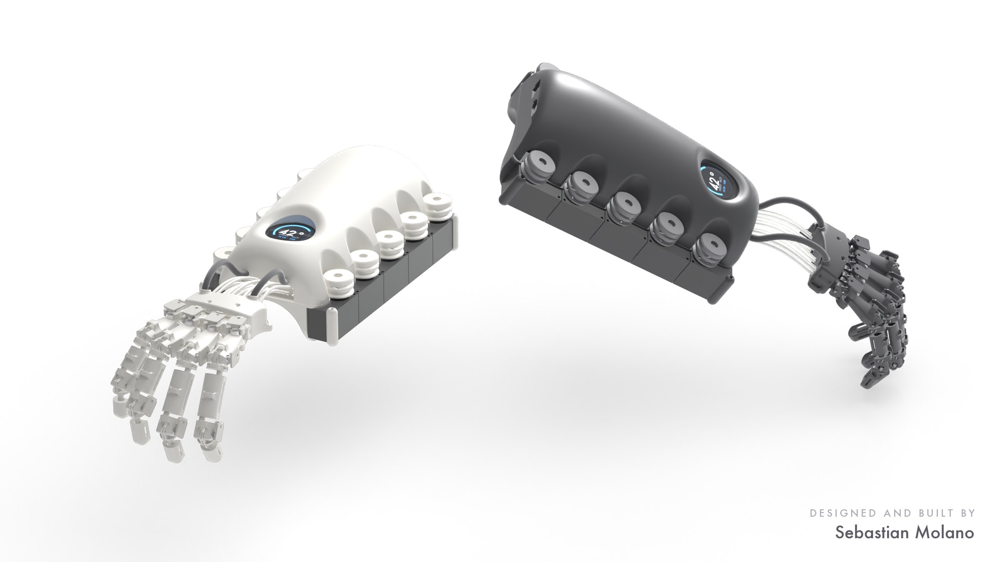

# TAKTO ONE

Open-source hand exoskeleton: twelve joint encoders, tendon drive, control on a Teensy 4.1

[](https://takto.one)
[](https://youtu.be/t-M-R6erIa0)
[](LICENSE.md)
[](LICENSE.md)
[](LICENSE.md)
[](firmware/)
[](CONTRIBUTING.md)


</div>

TAKTO ONE is a fully actuated hand exoskeleton that I designed and built for my master's thesis
at Hochschule Anhalt. Magnetic encoders on the finger joints measure twelve angles, three on
each long finger, and servos on the forearm pull each finger through its own tendons. A Teensy
4.1 on the device reads the sensors and runs the motors, so it works without a PC. This repository has the files to build
one: CAD, circuit boards, firmware, software and the bill of materials.

Every long finger's tendon drive is built. Two servos are fitted so far, and every finger's
drive was tested with them. All twelve encoders work on the worn device. Force, latency and
assistance haven't been measured yet, and there's no thumb. More under [Status](#status).

You can try the 3D model, the live twin and the console at [takto.one](https://takto.one)
without any hardware. Without a device they run on simulated data.

---

## Video

<!-- Real footage, side by side. On a desktop each clip loops as a GIF with no click; phones and
     the GitHub app get the still poster (the Android app cannot show a README that loads a GIF).
     A click or tap opens the full film through jsDelivr, pinned to the commit that added it,
     because GitHub's blob page will not play a file this size. Keep <a>, <picture> and  on
     separate lines: written on one line, GitHub wraps the  in its own link and the GIF
     never loads. -->

<div align="center">

<a href="https://cdn.jsdelivr.net/gh/molanocortes/takto-one@d8c04761f672f3876d8088133d9401f613b00abd/docs/media/TAKTO-AR.mp4">
<picture>
  <source media="(min-width: 768px) and (pointer: fine) and (prefers-reduced-motion: no-preference)" srcset="docs/media/ar-loop.gif">
  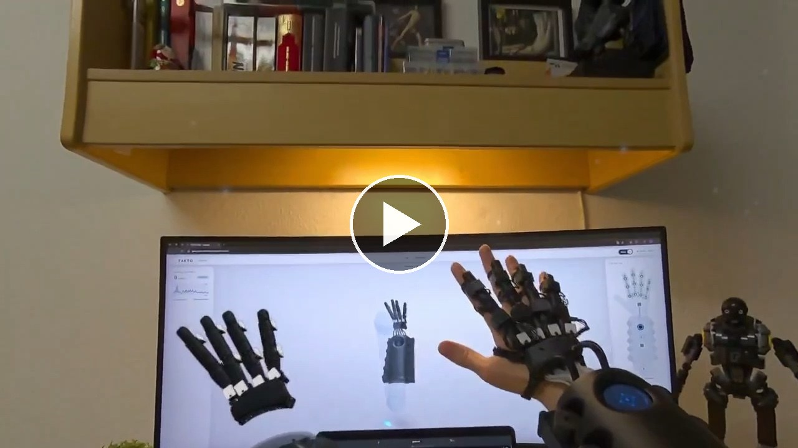
</picture>
</a>

<sub>Recorded through a Quest headset. The twin's fingers are moved by the twelve encoders and
its wrist by the two IMUs, not by the headset's hand tracking. The web twin is on the monitor
behind. The AR part is a prototype.</sub>

</div>

<!-- 2026-10-14: the film is now on YouTube ("I Built a Robot Exoskeleton for My Hand", https://youtu.be/t-M-R6erIa0),
     and the poster links there: GitHub cannot embed a YouTube player, and a youtu.be link opens
     the YouTube app on a phone and plays in the browser on desktop, one tap either way. The
     attachment URL https://github.com/user-attachments/assets/3c247700-2d8c-4fc3-9e42-16625cd077bb
     still plays the in-repo copy if YouTube is ever unavailable. Earlier notes:
     The film: a poster image linking to a GitHub attachment URL. This is the ONE form that
     works on desktop web AND in the GitHub mobile app, verified 2026-09-04. How the others fail:
       - a <video> tag is stripped by GitHub's sanitiser everywhere; only what is inside survives
       - a bare user-attachments URL on its own line becomes an inline player on desktop web only;
         the mobile app renders it as a plain link
       - a relative link to the in-repo .mp4 opens the blob player on desktop, dead tap in the app
     The attachment is served as video/mp4 with no download disposition, so tapping plays natively.
     docs/media/TAKTO-ONE.mp4 is the durable in-repo copy (v057). The URL below was minted by
     dragging that file into a comment on PR #1 and POSTING the comment: attachments dragged in but
     never posted are garbage-collected, which is how the two previous URLs died. To update the film:
     replace the in-repo file, drag the new one (under 10 MB) into a comment on PR #1, post it,
     verify the URL logged out, then swap it here. -->


<div align="center">
<!-- The film plays by itself on desktop: film-loop.gif is seconds 6.5 to 22 of TAKTO-ONE.mp4,
     silent, 720 px, 12 fps. Phones get film-poster.jpg; a click or tap opens the full film on YouTube. -->

<a href="https://youtu.be/t-M-R6erIa0">
<picture>
  <source media="(min-width: 768px) and (pointer: fine) and (prefers-reduced-motion: no-preference)" srcset="docs/media/film-loop.gif">
  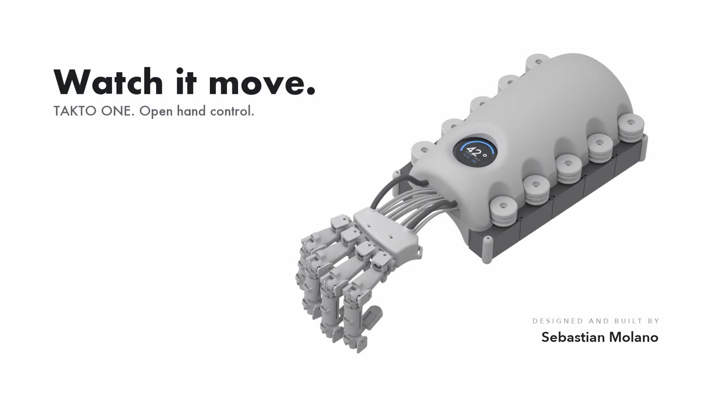
</picture>
</a>

  <sub>▶ <a href="https://youtu.be/t-M-R6erIa0"><b>Watch the film on YouTube</b></a></sub>
</div>

---

## Website

[takto.one](https://takto.one) is the project website, and its source is in
[`software/web/`](software/web/). It's a single page: the device in three colours, the six parts
it's made of, the main numbers and a 360° view, followed by the live twin and the operator
console, which only talks to a real TAKTO ONE when you connect one on your own computer.

<div align="center">
<a href="https://takto.one">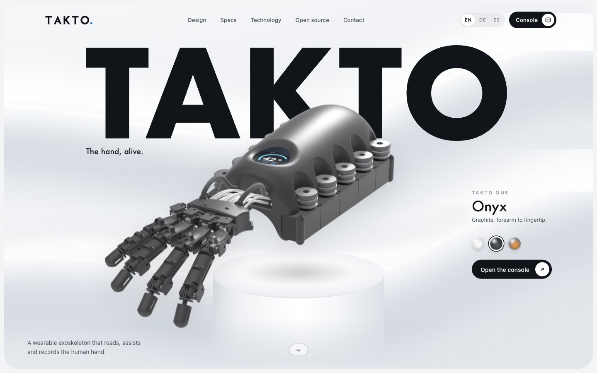</a>

<sub>The main page. You can switch between the three colours, scroll through the parts and the
numbers, and turn the model through 360°.</sub>
</div>

<div align="center">

<a href="https://takto.one/#/operator">
<picture>
  <source media="(min-width: 768px) and (pointer: fine) and (prefers-reduced-motion: no-preference)" srcset="docs/media/console-live.gif">
  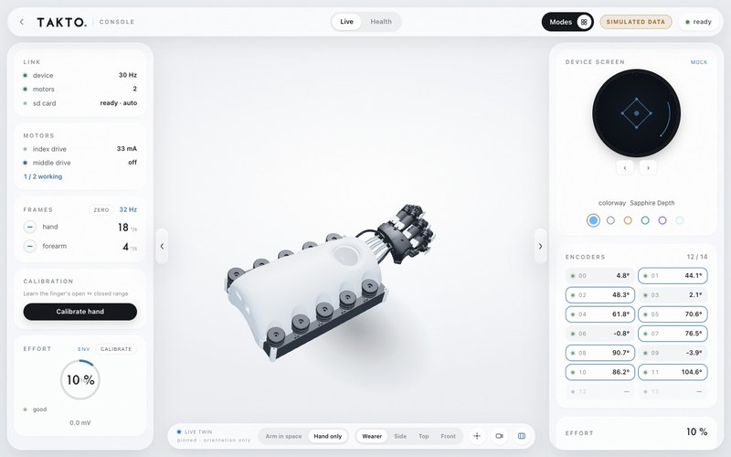
</picture>
</a>

<sub>The console on the built-in simulation (marked SIMULATED DATA, top right): the arm in 3D
with the fingers opening and closing, the twelve encoder channels, the motors and the effort
gauge. With a real TAKTO ONE connected on your own computer, the same view shows live data.</sub>

</div>

The site is in English, German and Spanish, and it has no cookies, analytics or trackers.
The camera modes ask before loading anything from a third party, and the camera video stays in
your browser. Simulated data is labelled SIMULATED wherever it appears, and nothing is shown as
live unless a real device is sending it. The site is served by Cloudflare, the console's code
only loads when you open it, and the 3D model is compressed for the web.

To build the site yourself, run `node software/web/tools/build-site.mjs <outDir>`. It bundles
and minifies everything into a folder that any static host can serve. It uses `esbuild`, or
fetches it with `npx` if it isn't installed.

---

<div align="center">

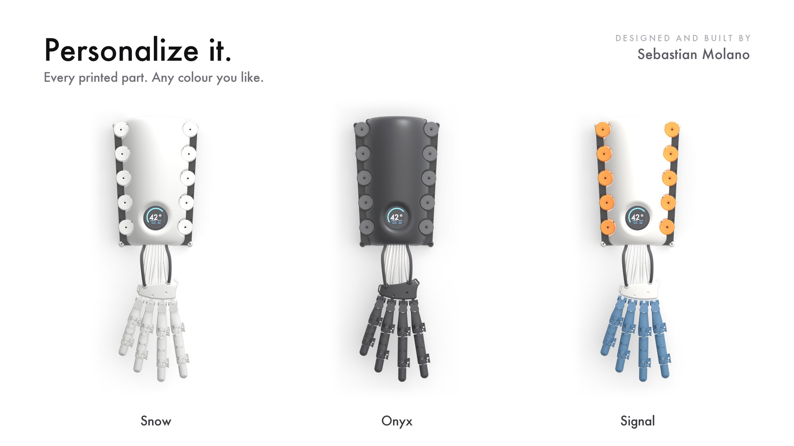

</div>


---

## Why encoders at the joints

Cameras lose track of fingers when they cross, curl or leave the frame, and gloves with flex
sensors drift. TAKTO ONE has three magnetic encoders on each long finger, twelve in total:
flexion and sideways spread at the knuckle, and flexion at the middle joint. Each one measures
its angle directly, so a hidden finger or bad lighting doesn't matter.

The Teensy that reads the encoders also drives the motor bus, so the control loop runs on the
device with no computer attached. You can use it to record a hand or to control something else,
and its motors can move the fingers.

<div align="center">

<a href="https://cdn.jsdelivr.net/gh/molanocortes/takto-one@d8c04761f672f3876d8088133d9401f613b00abd/docs/media/TAKTO-WORN.mp4">
<picture>
  <source media="(min-width: 768px) and (pointer: fine) and (prefers-reduced-motion: no-preference)" srcset="docs/media/worn-loop.gif">
  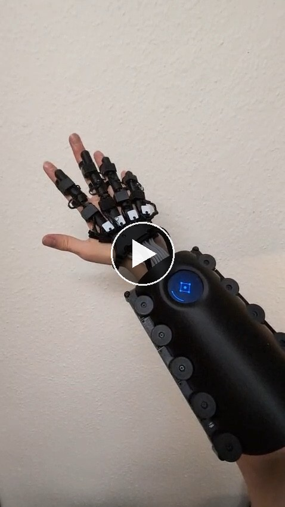
</picture>
</a>

<sub>The black build on the arm, filmed with a phone on 14 October 2026.</sub>

</div>

## Recording and control

**Recording.** The firmware writes one row per frame to the Teensy's SD card: all fourteen
encoder channels, the hand, forearm and thumb quaternions, the EMG envelope and RMS, the crown,
and the motor telemetry. The SD log, the serial stream and the display all come from the same
sensor read, so the log always matches what you saw live. The logging rate is set in the
firmware and doesn't depend on a display. Each row is timestamped, and because the angles are
measured at the joints, the data can be used as ground truth, for example to train
hand-tracking models.

**Control.** The control law runs on the Teensy and has three modes: idle, direct current, and
a blend between *transparent*, where the device follows the wearer, and *assist*, where it
drives toward a setpoint. The blend can be changed while it runs. Setpoints, gains and current
limits come over the serial protocol, so a recording or a second device can supply them.

<div align="center">

<a href="docs/media/turntable.gif">
<picture>
  <source media="(min-width: 768px) and (pointer: fine) and (prefers-reduced-motion: no-preference)" srcset="docs/media/turntable.gif">
  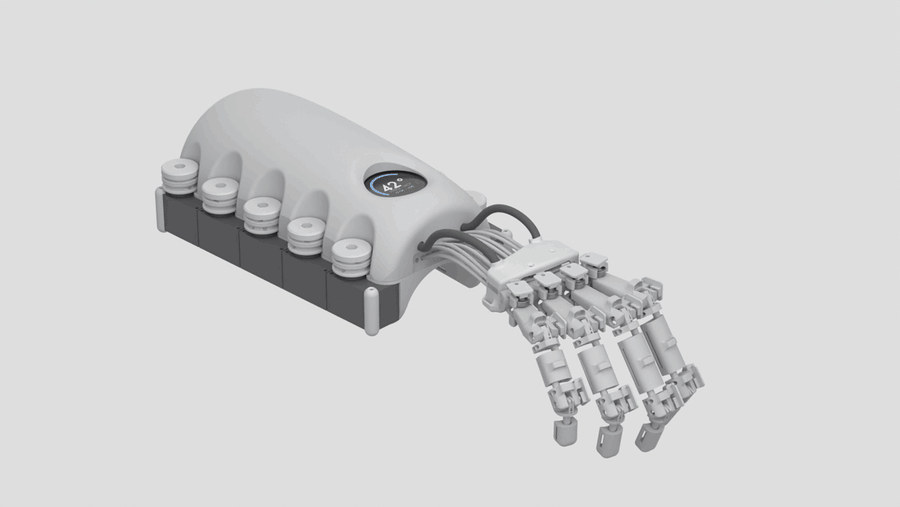
</picture>
</a>

</div>

---

## Circuit boards

Both boards were designed in KiCad for this device. The schematics, layouts and manufacturing
files are in [`electronics/`](electronics/), and the renders below come from those files.

<table>
<tr>
<td width="58%">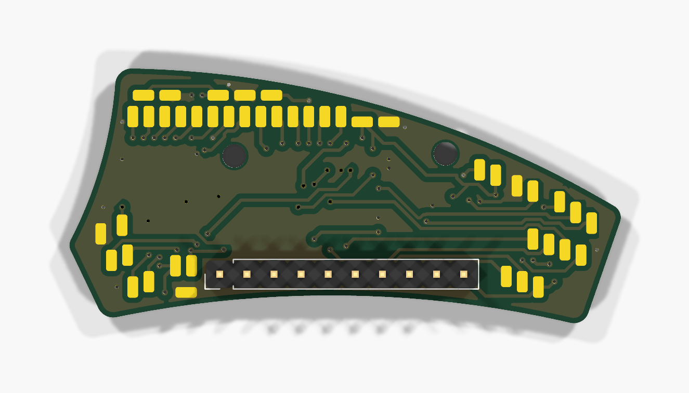</td>
<td width="42%">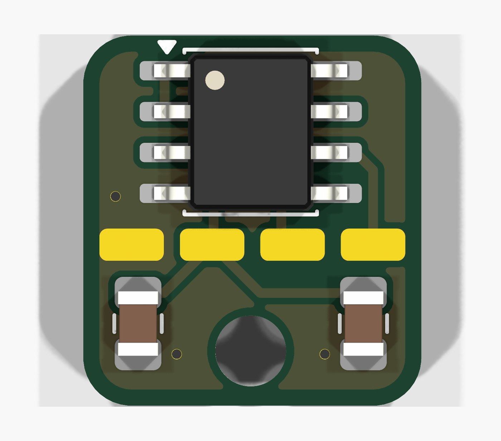</td>
</tr>
<tr>
<td align="center"><b>Palm carrier</b></td>
<td align="center"><b>Encoder board</b></td>
</tr>
</table>

- Palm carrier (`palm_carrier/`): shaped to fit the curved palm plate. Two TCA9548A I²C
  multiplexers split the bus into fourteen encoder channels, twelve for the joints and two
  spare for a thumb.
- Encoder board (`encoder_board/`), one per joint: an AS5600 magnetic angle sensor centred
  under a hole through the board, which keeps the joint's magnet on the sensor's axis.

Both were made and assembled by JLCPCB in one order (June 2026, USD 170.73 delivered); the
[bill of materials](docs/BOM.md) lists it. There is one known error: on the palm carrier, the
second multiplexer's SDA and SCL labels are swapped on channels 8 to 13, so those six channels
are wired crossed. [`electronics/README.md`](electronics/README.md) has the details. The 74HC241
servo-bus interface isn't on these boards; its pins are in the firmware and in the wiring
diagram below.

## Architecture and wiring

Sensing → aggregation → control → interface:

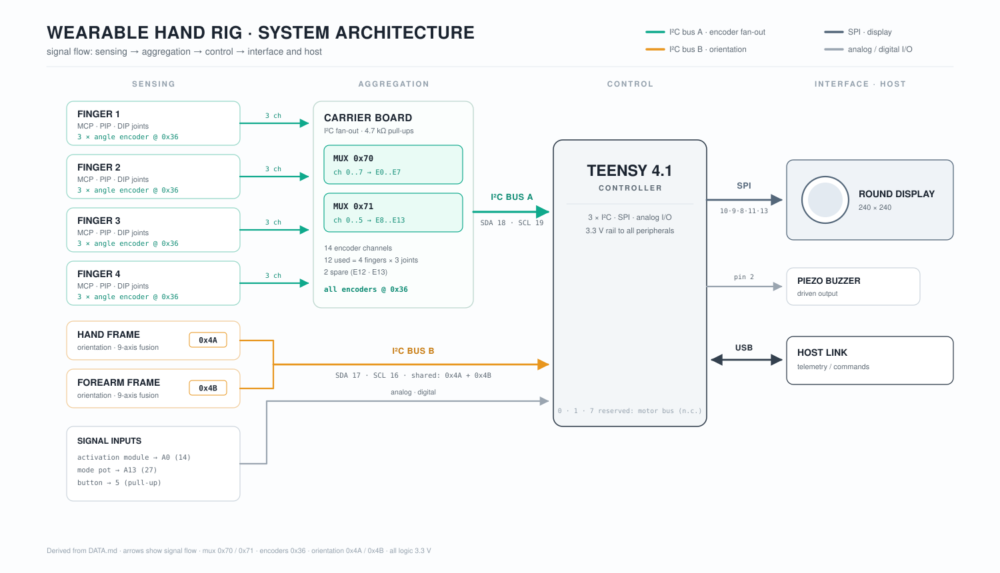

The wiring diagram shows every pin-to-pin connection: both I²C multiplexers, all fourteen
encoder channels, all three IMU positions and the 74HC241 servo bus. There is also a printable
[PDF](docs/global-wiring.pdf).

<a href="docs/global-wiring.pdf">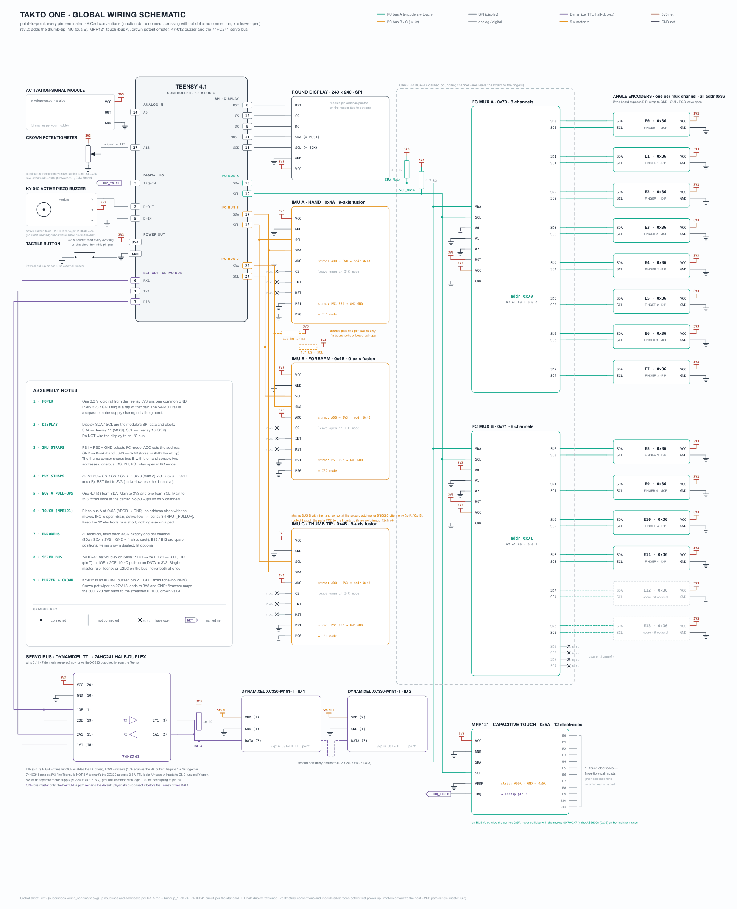</a>


---

## Session replay

A recorded session can be replayed wherever the twin runs. The viewer shows the device's 3D
model moved by the twelve recorded joint angles, the wrist following the 6-DoF path measured by
the headset, the room from the environment mesh saved with the recording, and the flexion and
effort traces under the timeline. You can play it at any speed and look at it from any angle.

<!-- Loops on phones. GitHub loads every image in a README at once (it strips loading="lazy"),
     and the five GIFs on this page weigh 16 MB. The GitHub Android app also cannot show a README
     with a GIF in it: the page flickers on every frame and reads as empty (github.com/orgs/
     community/discussions/158337), and the app ignores <source>. So each loop is a <picture>
     whose  is a still frame (docs/media/<name>-still.*), which phones, the app and
     reduce-motion readers get, and whose <source> hands the GIF only to a wide screen with a
     mouse; a tap on the still opens the loop. Keep "prefers-color-scheme" out of that media
     query: GitHub's <themed-picture> rewrites any <source> that mentions it. -->

<div align="center">

<a href="docs/media/ui-replay.gif">
<picture>
  <source media="(min-width: 768px) and (pointer: fine) and (prefers-reduced-motion: no-preference)" srcset="docs/media/ui-replay.gif">
  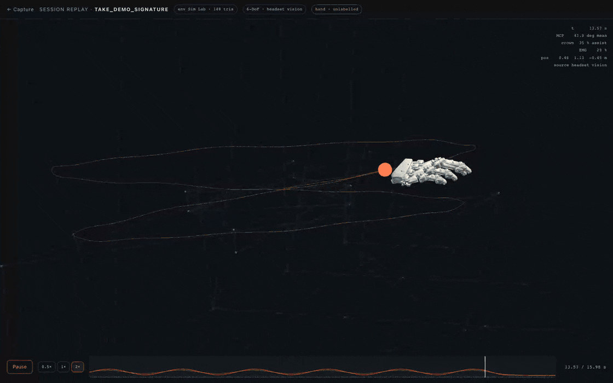
</picture>
</a>

<sub><b>take_demo_signature</b> at 2× speed in the viewer. It's one of three sample recordings
in [`software/bridge/samples/`](software/bridge/samples/). They are synthetic, made by a script
in the same folder, and you can play them on your own computer without hardware.</sub>

</div>

The viewer reads the same format the device writes to its SD card, so your own recordings work
too. Saving and loading a room mesh works end to end, but reconstructing the room from the
Quest 3S isn't done yet; the viewer, the storage and the upload path are ready for it. If you'd
like to work on that, see [Contributing](#contributing).


---

## AR viewer (LUMEN)

Source: [`software/ar/`](software/ar/)

LUMEN shows the hand twin and its data in the room around you instead of on a monitor. It reads
the same WebSocket stream as the console, needs no separate backend, and also runs in a normal
desktop browser, which is where the frames below were captured. In a headset it looks like
[this recording](https://cdn.jsdelivr.net/gh/molanocortes/takto-one@d8c04761f672f3876d8088133d9401f613b00abd/docs/media/TAKTO-AR.mp4) from October 2026.

<div align="center">

<a href="docs/media/ar-modes-live.gif">
<picture>
  <source media="(min-width: 768px) and (pointer: fine) and (prefers-reduced-motion: no-preference)" srcset="docs/media/ar-modes-live.gif">
  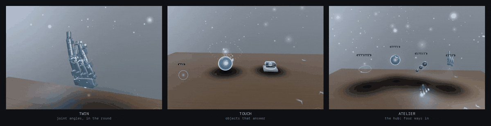
</picture>
</a>

<sub>Three of the modes in a desktop browser: <b>twin</b>, the hand driven by the joint angles, seen
from a moving camera &nbsp;·&nbsp; <b>touch</b>, objects that react to the wearer's fingers
&nbsp;·&nbsp; <b>atelier</b>, the start screen, where you pick one of the other four modes by
reaching for an object instead of pressing a button.</sub>

</div>

There are five modes: `atelier` (the start screen), `twin`, `touch`, `rhythm` and `capture`.
The scene uses the device's own geometry, so the twin matches the device on your arm. There are
also a few decorative animations, butterflies and the odd comet, which stay out of the way.

> This is a prototype. Known bug on high-DPI screens: the render target is sized in CSS pixels
> while the canvas uses the device pixel ratio, so on a 2x display the scene only fills a
> quarter of the canvas. Setting the device pixel ratio to 1 works around it. A proper fix would
> be a good first contribution.


---

## Phone app

Source: [`software/app/`](software/app/)

The phone app shows the twin, replays recorded sessions, and displays the twelve joint angles
and the activation (EMG) channel. It uses the same stream and protocol as the console, and it's
one Expo codebase for iOS, Android and the web.

<div align="center">

<a href="docs/media/app-live.gif">
<picture>
  <source media="(min-width: 768px) and (pointer: fine) and (prefers-reduced-motion: no-preference)" srcset="docs/media/app-live.gif">
  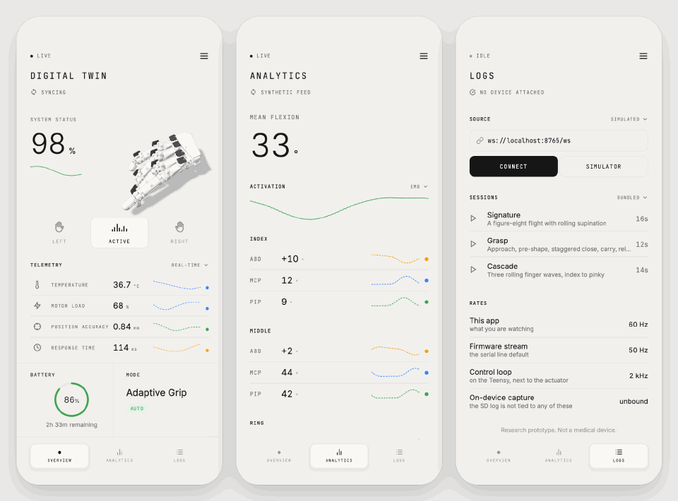
</picture>
</a>

<sub><b>Overview</b>, the device status &nbsp;·&nbsp; <b>Analytics</b>, the twelve joint angles and
the activation channel &nbsp;·&nbsp; <b>Logs</b>, the data source, the bundled sessions and the rates</sub>

<sub>A wave from the index to the little finger on the synthetic feed, with the twelve joint
angles moving independently. All three screens run on the same clock, so they show the same moment.</sub>

</div>

The twin is the CAD model, posed by the shared mechanical model in
[`kinematics.js`](software/app/src/data/kinematics.js), which works out the telescopic slides
and spool rotations for each set of joint angles. Without hardware the app runs on the same
synthetic feed as the other viewers, and its three bundled sessions are this repository's
sample recordings. Connected to a bridge, it reads a real device.

This app replaces an earlier Android-only build.


---

## Display

The Teensy drives a round display, and the code that draws it is part of the firmware. There
is one face design, **thesis**, in three colours (Sapphire Depth, Graphite and Amber), with a
screen for every device state: battery, boot, calibrate, fault, idle, linked, recording, saved,
standalone, stop and teleop. Two earlier designs, **rams** and **ferro**, are still in the
source for reference but aren't built into the firmware.

Most screens move. At boot and when idle a marker sweeps around the ring, the teleop screen
shows the effort level as a ring and a percentage, and the recording screen counts the time
with a ring that fills once a minute. The renderer only redraws the tiles that changed and keeps
to a fixed time budget per frame, so drawing doesn't hold up the control loop.

<div align="center">

<a href="docs/media/watch-faces-live.gif">
<picture>
  <source media="(min-width: 768px) and (pointer: fine) and (prefers-reduced-motion: no-preference)" srcset="docs/media/watch-faces-live.gif">
  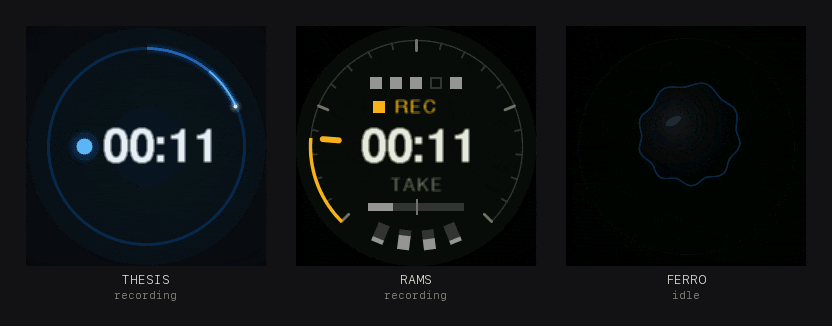
</picture>
</a>

<sub>Drawn by the firmware's own renderer from mock data, at real speed: the boot sequence of
the <b>thesis</b> face and the two older designs, then the <b>recording</b> counter, then
<b>idle</b>.</sub>

</div>

<div align="center">

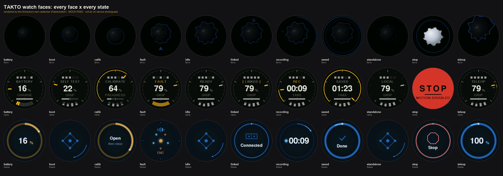

<sub>The thesis face (bottom row) and the two older designs in every state. These are renders,
not photos of the real screen, and they were made before the thesis face's calibrate and linked
screens changed.</sub>

</div>

The source, the drawing engine, the frame budget and the flashing instructions are in
[`firmware/takto_one/watch/`](firmware/takto_one/watch/).

---

## EMG

TAKTO ONE has an input for muscle activity (EMG): a MyoWare 2.0 sensor with snap connectors
for standard disposable Ag/AgCl gel electrodes, two on the muscle and a reference on a nearby
bone. The MyoWare board amplifies and rectifies the signal and outputs its envelope, which the
firmware reads on pin 14.

The firmware samples the envelope at about 1 kHz between the 50 Hz frames, reduces it to a mean
and an RMS value, and writes both into every frame of the stream and every row of the SD log,
on the same clock as the twelve encoders and the IMUs.

Having all three on one clock matters because muscle activity starts a little before the
joints move. That makes the data useful for training models that detect movement intent, or as
an extra input for a controller. The console and the website both plot the live EMG channel.

<div align="center">

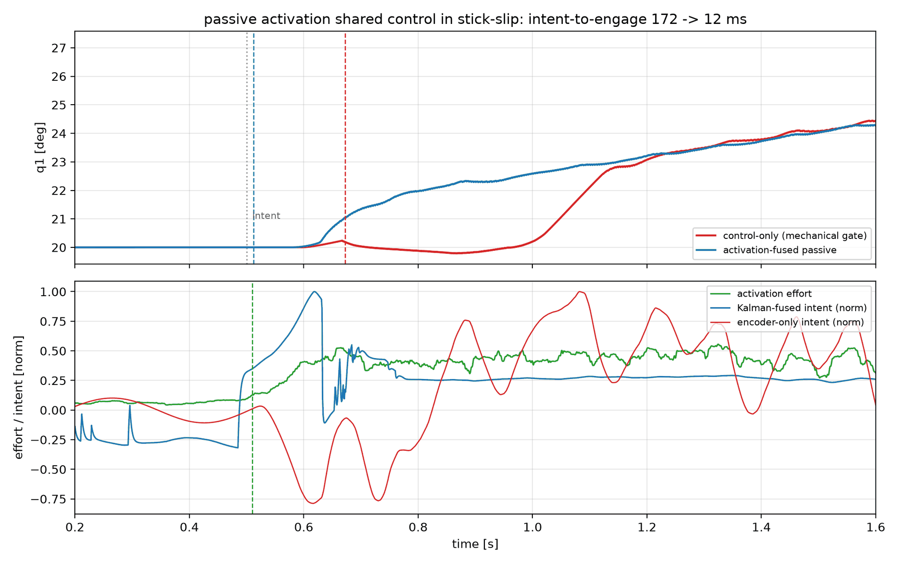

<sub><b>Simulation, not a measurement on a person.</b> From the project's intent-detection work
on a synthetic signal model: in a stick-slip scenario, the observer that uses only the encoders
takes 172 ms to switch on assistance, and adding the EMG channel brings that down to 12 ms.
That research controller is passive by design, so it can't move the joint on its own.</sub>

</div>

The figure comes from research outside this release: a causal filter chain (band-pass, notch,
RMS envelope), a whitened Bayesian decoder, and an energy-tank shared-control law in which EMG
detects intent during isometric loading, before the encoders see any movement, while a
passivity condition keeps the controller from driving the joint by itself. It has only been
tested against the synthetic signal model, with reproducible test reports, and not on people.
If you work on intent detection, the device could be a useful test platform.

---

## Sign language recognition

TAKTO-SIGN is a German Sign Language project built on this hardware. It records finger bend
and hand orientation at 60 Hz, trains on a chosen set of signs and recognises them live. Its
capture and live-recognition pages are part of the website code here
([`sign.js`](software/web/src/views/sign.js), [`translate.js`](software/web/src/views/translate.js)),
but the recogniser, its training code, the inference server and the `--sim` mode that runs it
without hardware are not in this repository.

It recognises isolated signs and is trained for one signer. It also handles scripted continuous
sentences, and it has been measured on a signer it wasn't trained on. It doesn't translate open
vocabulary.

## Possible uses

Most of these aren't built yet, and each would be a project of its own.

- Controlling a robot hand with the measured joint angles, without cameras or a capture
  volume, including robots somewhere people can't easily go, like underwater or in a hot cell.
- Collecting hand-motion datasets. Recording already works; what's missing is many people, many
  tasks and a shared format.
- Sign language recognition, which has already started (see above).
- Force feedback on each finger. The control modes are in the firmware, but rendering haptic
  forces isn't.
- Rehabilitation research: measuring range of motion across sessions, and helping a hand finish
  a movement it can't complete alone.
- Controlling machines where a joystick is too coarse and a touchscreen can't be used, for
  example with gloves on, when it's wet, or in the dark.

What works today is listed under [Status](#status).

---

## Specifications

| | |
| --- | --- |
| **Mechanism** | Tendon-driven; four long-finger assemblies with three encoders each |
| **Actuation** | Dynamixel XC330 servos, two per digit, in ten spool bays (eight for the long fingers, two for the thumb). Two servos fitted, every finger's drive tested with them. Series elasticity from elastic tendons and ratchet spools |
| **Joint sensing** | 12 × AS5600 magnetic encoders: MCP abduction, MCP flexion and PIP flexion on each long finger; no DIP sensor. The bridge names these channels `_mcp`, `_pip` and `_dip` by encoder position |
| **IMUs** | 2 × BNO085, on the hand and the forearm; a third position (thumb tip) is wired but not fitted |
| **EMG** | MyoWare 2.0, with snap connectors for standard Ag/AgCl gel electrodes; envelope and RMS in every frame |
| **Controller** | Teensy 4.1 |
| **Motor bus** | Dynamixel Protocol 2.0 through a 74HC241 half-duplex interface, driven by the Teensy; no PC needed |
| **Electronics** | 2 custom PCBs, with KiCad sources and manufacturing files |
| **Interface** | Browser console with a live 3D twin, through a serial-to-WebSocket bridge |
| **Structure** | 3D printed; the prototype as built is a mix of PETG and PLA |
| **Parts** | 71 printed parts, 12 encoder boards, ten servo bays. Full [bill of materials](docs/BOM.md) |


---

## Cost

There are two versions, built from the same files:

| | **TAKTO Lite** | **TAKTO ONE** |
| --- | --- | --- |
| What it does | Reads the hand: 12 joint encoders, 2 IMUs, EMG, on-device display and SD logging, the live twin in the browser, the phone app and AR | Reads and drives the hand: everything in Lite, plus servos that pull the fingers through tendons, two per digit (priced for the four long fingers, so 8 servos) |
| Priced parts | **EUR 164.48** | **EUR 1,222.25** |
| Both circuit boards, one JLCPCB order | USD 170.73 | USD 170.73 |

Lite leaves out the parts that serve the motors: the eight servos, the tendons and conduit, the
74HC241 bus driver and the motor power supply. It runs the same firmware, which doesn't touch
the motor bus until it's told to (`M,t,1`), so a Lite build streams, logs and drives the twins
without any servos fitted. The forearm still has its ten spool bays, so you can turn a Lite
into a ONE later by adding the actuation parts.

In TAKTO ONE the eight servos cost EUR 1,040 of the EUR 1,222.25; the other priced parts come to
EUR 182.25. Using fewer motors would make it much cheaper to build.

<div align="center">
  <picture>
    <source media="(prefers-color-scheme: dark)" srcset="docs/media/bom-cost-dark.svg">
    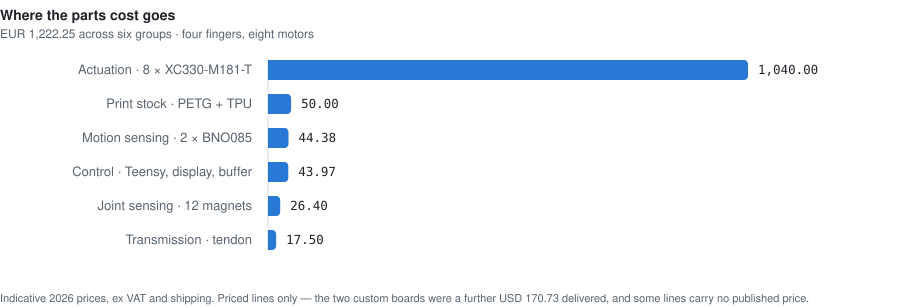
  </picture>
</div>

Part numbers, suppliers, quantities and notes are in [`docs/BOM.md`](docs/BOM.md), with a CSV
copy in [`docs/bom.csv`](docs/bom.csv).


---

## Getting started

The console runs on simulated data, so you can try the software before printing anything. If
you only want to look around, [takto.one](https://takto.one) runs the same twin and console
without cloning anything.

```bash
git clone https://github.com/molanocortes/takto-one.git
cd takto-one

# run the console and the 3D twin on simulated data (no hardware needed)
python3 -m http.server 8096 --directory software/console/app
# open http://localhost:8096/
```

Then read [`docs/README.md`](docs/README.md) for the system architecture, the illustrated build
guide and a list of known differences between the documentation and the current hardware.

| Step | Where |
| --- | --- |
| Source the parts | [`docs/BOM.md`](docs/BOM.md) |
| Choose and print parts | [`cad/README.md`](cad/README.md) |
| Order and wire the boards | [`electronics/README.md`](electronics/README.md) |
| Flash the Teensy | [`firmware/README.md`](firmware/README.md) |
| Connect the twin to hardware | [`software/README.md`](software/README.md) |

The Dynamixel driver for the Teensy is also available on its own as
[dynamixel-on-device](https://github.com/molanocortes/dynamixel-on-device).


## Status

Every long finger has its own tendon drive, and all four are built. The forearm has ten spool
bays, two per digit, and the bus and the bill of materials are laid out for them. I paid for the
prototype myself, so two servos are fitted, and every finger's drive was tested with them.

What works on the hardware:

- The firmware runs on the device. The Teensy drives the Dynamixel bus through the 74HC241 and
  moves the fingers with the two fitted XC330 servos. Every finger's drive was tested with them,
  and the transmission was run on the bench with and without its elastic element.
- All twelve encoders read live at the same time on the worn device and drive the browser twin
  in real time. As of 14 October 2026 they also drive the AR twin in a Meta Quest 3S (the video
  at the top of this page). A wiring fault cut four channels earlier in October; the harness
  has been repaired.
- Two BNO085 IMUs are fitted, on the hand and the forearm.
- Four long-finger assemblies are built with their encoders, and both PCBs have been made from
  the published design files.

The firmware and the wiring also have a channel for a third IMU at the thumb tip, which isn't
fitted, in the same way that the two multiplexers have fourteen encoder channels for twelve
encoders. The empty channel shows MISSING in the `s` bus scan, streams a live flag of 0 and
logs an identity quaternion, so it can't be mistaken for real data.

Not measured yet: force rendering, transparency (how little the device resists free movement),
latency and assistance behaviour. Before any worn experiment, check the actuator count (the
released firmware is set to two, `N_MOTOR = 2`), the limits and the safety behaviour on your own
hardware. The checks done before release are in the
[verification record](docs/RELEASE_VERIFICATION.md).

Known limitations:

- The servos make TAKTO ONE expensive. TAKTO Lite avoids that cost if you only need the
  sensing.
- The series elasticity is simple (elastic tendons and ratchet spools), not a full
  series-elastic actuator design.
- Some recent soft-robotics work gets similar sensing from simpler mechanisms.
- There is no thumb yet.

### Rates

Three different rates are easy to mix up:

- Browser console: 60 Hz. The bridge sends a snapshot to the connected browsers 60 times a
  second. This is a display rate.
- Firmware frames: 50 Hz by default (`SAMPLE_HZ` in the sketch in this release). Each frame
  reads the sensors once and feeds the serial stream, the SD log and the display, so the SD log
  also gets one row per frame, whatever the console shows. The development firmware, not
  released here yet, runs at 100 Hz, which is the number on takto.one.
- Control loop: up to 2 kHz, on the Teensy next to the actuators.

The maximum encoder sampling rate depends on the I²C bus and the multiplexer switching, and I
haven't measured it. If your application needs a specific rate, measure it on your build.

## Safety

> TAKTO ONE is an experimental research prototype. **It is not a medical device and not a
> certified protective product.** Do not use it for diagnosis, treatment, unsupervised
> rehabilitation, or safety-critical operation.

Before any worn experiment, make sure the motor power can be switched off separately from the
rest, start with torque disabled, test away from the body first, check the mechanical limits,
and test the watchdog and the fault handling.


## Frequently asked questions

**What is TAKTO ONE?**
An open-source, fully actuated hand exoskeleton. It measures twelve finger joints with magnetic
encoders at the joints and drives each finger through tendons from servos on the forearm, two
per digit. A Teensy 4.1 runs the control loop on the device, so no PC is needed. Sebastian
Molano designed and built it for his master's thesis in biomedical engineering at Hochschule
Anhalt, Germany, and released it as open source in September 2026. Website:
[takto.one](https://takto.one).

**How much does it cost to build?**
TAKTO ONE, the full build, comes to EUR 1,222.25 in priced parts; TAKTO Lite, sensing only,
to EUR 164.48. Both need the two custom circuit boards, USD 170.73 as one JLCPCB order. Every
line is in [`docs/BOM.md`](docs/BOM.md).

**Can I build it without motors?**
Yes. TAKTO Lite is the same device without the actuation: twelve joint encoders, two IMUs, EMG,
the display, SD logging and the live twin. It uses the same firmware and can be upgraded to
TAKTO ONE later.

**How is it different from camera hand tracking or a flex-sensor glove?**
A camera loses fingers when they cross, curl or leave the frame, and flex sensors drift. TAKTO
reads each joint angle with a magnetic encoder at the joint, so a hidden finger is still
measured.

**Does it work in VR or AR?**
Yes, as a prototype. LUMEN runs in WebXR on a Meta Quest 3S, and its twin is moved by the
device's own encoders and IMUs, not by the headset's hand tracking.

**Can I try it without building it?**
Yes. [takto.one](https://takto.one) runs the 3D twin and the operator console in any browser on
simulated data.

**What works today, and what doesn't?**
Working on hardware: all twelve encoders, two IMUs, on-device logging, the browser, phone and
AR twins, and the tendon drive of every long finger. Two servos are fitted, because the
prototype was self-funded, and every finger's drive was tested with them. The EMG input is in
the firmware and is logged with every frame. Not done yet: the thumb, and measurements of
force, latency and assistance. Details and dates are under [Status](#status).

**Is it a medical device?**
No. It is a research prototype, not certified for clinical use. Read [Safety](#safety) before
wearing a build with motors.

**Under what licence?**
Hardware CERN-OHL-S-2.0, software Apache-2.0, documentation and media CC BY 4.0. The TAKTO name
is not licensed; see [License](#license).

---

## Contributing

Contributions are welcome, and the limitations listed under [Status](#status) are a good place
to start.

- Build one and tell me what was unclear, what didn't fit and what you changed. Build reports
  help more than anything else.
- Improve the actuation. The current transmission works on the bench with and without its
  elastic element; a better series-elastic design is the biggest open problem.
- Use fewer motors. Two per digit is expensive, and an underactuated design would let more
  people build it.
- Build the thumb. Two of the ten spool bays are reserved for it, and the firmware already reads
  two spare encoder channels. The thumb's linkage, tendon routing and kinematics still need to
  be designed; the long fingers' already work.
- Room scanning. The replay viewer, the room storage and the upload path work end to end; what's
  missing is reconstructing the room from the Quest 3S.
- Documentation. Known differences between the docs and the hardware are listed in
  [`docs/README.md`](docs/README.md), and there are probably more.
- Firmware, bridge and console: bug fixes, features and ports to other platforms.

See [`CONTRIBUTING.md`](CONTRIBUTING.md). For questions, ideas or photos of your build, open an
issue. For anything that shouldn't be public, email
[sebastianmolano.eng@gmail.com](mailto:sebastianmolano.eng@gmail.com).

## License

Software: Apache-2.0. Hardware: CERN-OHL-S-2.0. Documentation and media: CC BY 4.0.
[`LICENSE.md`](LICENSE.md) has the details, the attribution format and the text-and-data-mining
reservation.

The hardware licence is strongly reciprocal: if you distribute a modified design, you have to
publish your changes. If that doesn't work for you, other licensing terms are available; see
[`LICENSE.md`](LICENSE.md). Contributors are asked to agree to a short [CLA](CLA.md), which
keeps relicensing possible and leaves your copyright with you.

TAKTO and TAKTO ONE are unregistered trademarks of Sebastian Molano and aren't covered by the
licences above. You can build, modify and sell the design and say it's based on TAKTO ONE, as
long as your version has its own name. Details are in [`LICENSE.md`](LICENSE.md).

<div align="center">
<sub>Designed and built by Sebastian Molano at Hochschule Anhalt, Germany<br>
<a href="mailto:sebastianmolano.eng@gmail.com">sebastianmolano.eng@gmail.com</a></sub>
</div>
