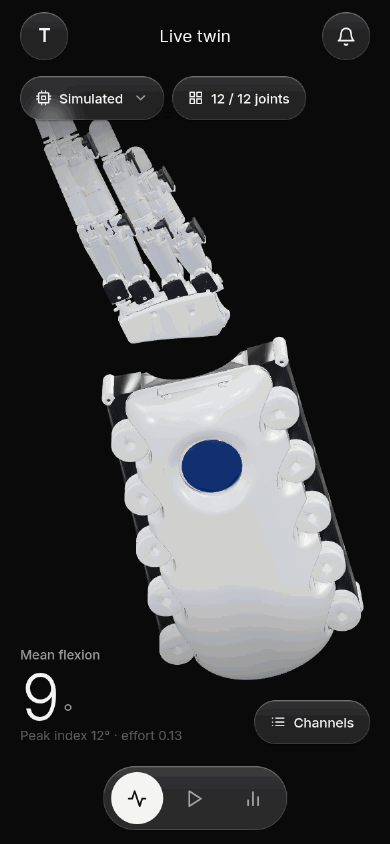

# TAKTO companion

A digital twin and dashboard for TAKTO ONE. It runs on iOS, Android and in the
browser from one codebase.

<div align="center">
<a href="../../docs/media/app-live.gif">
<picture>
  <source media="(max-width: 767px), (pointer: coarse), (prefers-reduced-motion: reduce)" srcset="../../docs/media/app-live-still.png">
  
</picture>
</a>
</div>

The app has three screens, and all three read the same data:

| | |
| --- | --- |
| **Overview** | The device at a glance: the twin lying on the page, the system health number and its trace, the hand picker, four housekeeping channels with live traces, the battery and the mode. |
| **Analytics** | The twelve joints and the activation channel as traces, finger by finger. |
| **Logs** | The source and its address, the bundled sessions to replay, and the four rates that are easy to confuse. |

The app runs with no hardware attached. It opens on a synthetic feed; when you
have a device, point it at a bridge from the Logs tab.

## Run it

```bash
npm install
npx expo start
```

Then press `w` for the browser, `i` for an iOS simulator, or `a` for Android.
A native run builds through Expo in the usual way (`npx expo run:ios`,
`npx expo run:android`) and needs the corresponding platform toolchain.

To drive it from real hardware, start the bridge and give the app its address
on the Logs tab:

```bash
SENSORYHAND_STATE_DIR=.takto-state python3 ../bridge/teensy_bridge.py --sim
```

`--sim` feeds synthetic joints; swap it for `--port /dev/cu.usbmodemXXXX` with
a Teensy attached. The default address is `ws://localhost:8765/ws`; from a
phone, use the machine's LAN address instead of localhost.

## What it is built on

- `assets/model/zero_hand_full.glb` is the repository's own full-resolution
  export of the V7 assembly: 607k triangles, with names and transforms
  unchanged. It ships without normals, so the loader welds its vertices and
  computes smooth ones. `zero_hand.glb` (143k, web-decimated) is kept beside
  it for low-memory devices; one constant in `src/twin/loadHand.ts` switches
  between them. The rig binds to the GLB's own node names, because those
  names identify the parts of the mechanism.
- `src/data/kinematics.js`, the mechanical model, is a byte-for-byte copy of
  the one in `software/console`. Joint angles, the telescopic slides they
  require and the spool rotations that produce them all come from it, and
  nothing in the twin is tuned by eye.
- The three bundled sessions are the repository's own samples from
  `software/bridge/samples/`. They use the real take format, so a take
  recorded by the device loads without changes.
- The bridge client reads the same `snap` frames as the operator console, so
  the app uses the real wire contract.

## The look

The interface uses a light theme. It was built to a reference screen and
checked against it pixel for pixel, at the reference's own size of 393 by 895
points:

- The page is a single warm grey. There are no cards; the only surfaces are
  the three-tile pickers and the tab bar, and the only lines are hairlines.
- There are two typefaces: JetBrains Mono in tracked capitals for every
  label, and Inter for words and numerals, at weight 300 for the large ones.
- The model lies on the page as in the product still: white and matte, seen
  from high up and in front, with a short soft shadow. It is the same
  articulated CAD described above, so it moves with the feed.
- Three signal colours are used for the traces and their dots: blue, green
  and amber. Green also marks the battery arc and the mode's AUTO tag.
  Nothing else is coloured.

The design tokens are defined once, in `src/ui/tokens.ts`. The components
every screen is built from are in `src/ui/primitives.tsx` and
`src/ui/Chrome.tsx`.

## Limitations

- The twin shows only the mechanism, with no person wearing it. Wrist
  articulation from the IMUs is not applied yet, and the device's thumb is
  not built.
- **Temperature, motor load, position accuracy, response time, battery and
  the health number are modelled by the synthetic feed**, not measured by the
  device. The bridge does not carry them yet; on a real link they show as a
  dash until the firmware reports them. The joints and the activation channel
  are part of the real wire contract.
- The reference still shows the tendon cables between hand and housing. The
  CAD export has no cables, so the twin shows none.
- The forearm screen in the twin lights up with activity. Only the glass is
  lit: the model carries no display content, so this is not a capture of the
  real panel.
- The bundled takes are **choreographed and synthetic**, as their README says.
  No hand wore the device to make them. The live synthetic feed is the same
  kind of data: a 32 s choreography in `src/data/sim.ts` that rests open and
  spread, and moves from that pose into taps, a bloom, a wave and a grasp.
- The samples write anatomical values into the `{f}_mcp` column, which the
  device's wire contract uses for MCP abduction. This app maps columns the
  same way `software/web/src/views/replay.js` does, so replayed abduction can
  read past the mechanism's 16 degree limit. The transport notes this, and
  the twin clamps the value.
- The full mesh is 10.9 MB in the bundle and 607k triangles on the GPU. It
  renders at 60 Hz on a laptop's software GL; on a low-end phone, flip
  `MODEL` in `src/twin/loadHand.ts` to `lite`.
- The app has been verified on the web target, which is also what the
  capture tool renders and where every image on this page came from. The
  iOS and Android bundles export from the same source
  (`npx expo export --platform ios` and `--platform android`), but neither
  has been run on a device or a simulator here, so treat the native targets
  as compiling but untested. `expo-blur` on Android needs
  `experimentalBlurMethod` to blur at all, which is an open item for the
  first device run.

## Regenerating the media

The synthetic feed is a pure function of time and the app accepts `?t=`,
`?screen=` and `?take=`, so every captured frame is reproducible. See
[`tools/capture.mjs`](tools/capture.mjs) for the stills and the loop frames,
[`tools/compose.mjs`](tools/compose.mjs) for the docs composite, and
[`tools/gif.mjs`](tools/gif.mjs) for the loop.
